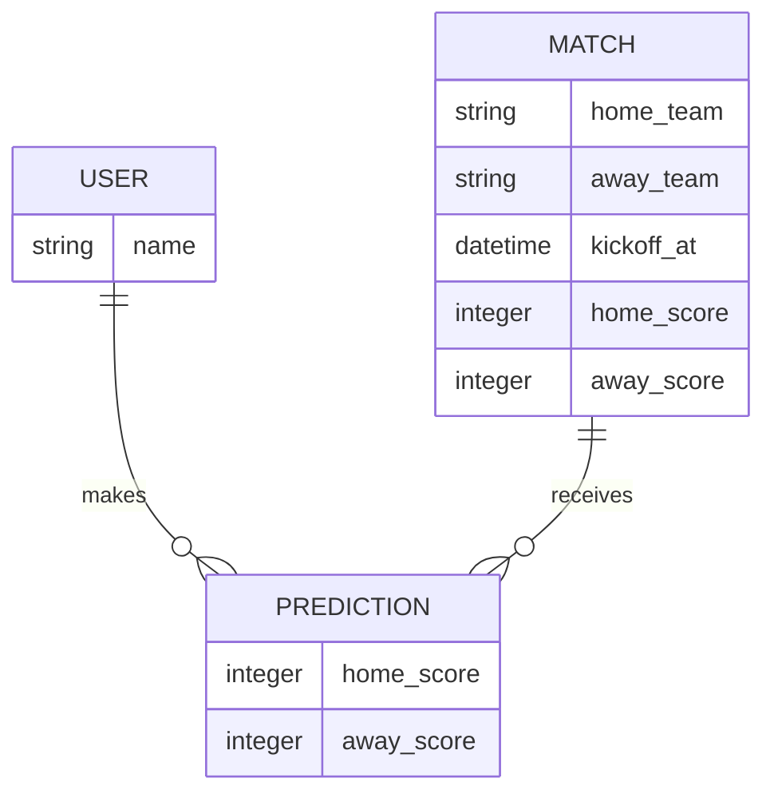

# Tippspiel

A football prediction game. Players predict match results, earn points based on accuracy, and compete on a leaderboard.

## Scoring

| Prediction | Points |
|---|---|
| Exact result | 3 |
| Correct goal difference | 2 |
| Correct outcome (win, draw, loss) | 1 |
| Otherwise | 0 |

Each player can predict a match only once.

## Tech Stack

- **Backend:** Ruby on Rails 8 (API mode), SQLite, Minitest
- **Frontend:** React, TypeScript, Vite

## Data Model



Uniqueness of one prediction per user and match is enforced both by a model validation and a unique database index.

## Getting Started

### Prerequisites

- Ruby 3.4
- Node.js (LTS)

### Backend

```bash
cd backend
bundle install
rails db:setup
rails db:seed
rails server
```

The API runs at http://localhost:3000.

### Frontend

```bash
cd frontend
npm install --legacy-peer-deps
npm run dev
```

The app runs at http://localhost:5173.

## API Endpoints

| Method | Path | Description |
|---|---|---|
| GET | `/api/matches` | All matches, ordered by kickoff |
| GET | `/api/leaderboard` | Players ranked by total points |

## Tests

```bash
cd backend
rails test
```

## Project Structure

```
.
├── backend/    # Rails API
└── frontend/   # React app
```